

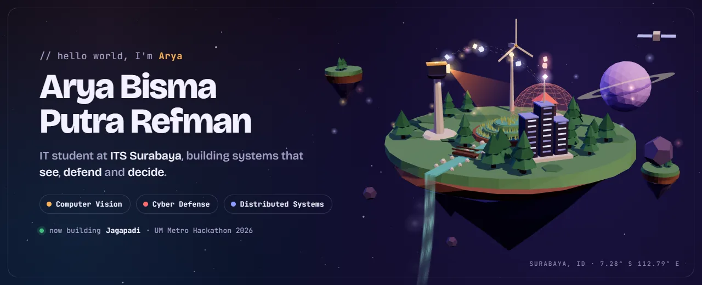

  

      

<a href="#awards">Awards</a> · <a href="#experience">Experience</a> · <a href="#featured-work">Featured work</a> · <a href="#research">Research</a> · <a href="#team--organisation-work">Teams</a> · <a href="#toolbox">Toolbox</a>

<table>
  <tr>
    <td width="46%" align="center" valign="middle">
      
    </td>
    <td width="54%" valign="top">
      <h3>About me</h3>
      

        I study <b>Information Technology at Institut Teknologi Sepuluh Nopember (ITS)</b> in Surabaya, Indonesia, with a <b>3.95 / 4.00 GPA</b>,
        and I'm head teaching assistant for Data Structures &amp; OOP.
        I like building systems that close the loop: they <b>see</b> what is happening, <b>defend</b> what matters, and help people <b>decide</b> what to do next.
      

      

        Most of my work is for people under pressure: farmers watching for drought, towns in the path of volcanic ash,
        refinery crews near red zones, expecting mothers, students learning algorithms, and SOC teams facing a flood of packets.
      

      

        <b>Now:</b> LLM agent security · JEPA world models · cloud scheduling 
        <b>Open to:</b> research collaboration, internships and hackathon teams
      

    </td>
  </tr>
</table>

## Awards

| | Result | Project | Competition |
| :---: | :--- | :--- | :--- |
| 🥈 | **2nd place** | [AlgoVerse](https://semoga-kami-beruntung.vercel.app/), AR visualisation of data structures and algorithms | [IT Fest 2026](https://itfest.ub.ac.id/home), Universitas Brawijaya |
| 🥈 | **2nd place** | [AromaSys](https://cyberhack-digendong-bokem.vercel.app/), warehouse intelligence platform | Cyberhack Hackathon, Xtremax × UCS ITS |
| 🏅 | **Finalist** | [SIEWS+ 5.0](https://github.com/aryarefman/migas-siews), AI safety system for upstream oil and gas | Hackathon AI/ML Hulu Migas 2026, SKK Migas × IOG 4.0 |
| 🏅 | **Finalist** | [Global AQI analysis](https://github.com/aryarefman/analisis-AQI-Dunia), PCA and clustering on world air-quality data | Data Science, IMILKOM IT Competition, Universitas Sumatera Utara |
| 🚀 | Competed | Jagapadi · HELALOKA · Standbai | UM Metro Hackathon 2026 · JOINTS UGM 2026 · ForgeHacks Online 2026 |

## Experience

| Role | Where | When |
| :--- | :--- | :--- |
| **AI NLP Backend Specialist** · AI backend lead for the patient AI module: API architecture, LLM integration, predictive models for early detection of pregnancy complications | Hamilku.ID | Jun 2026 – now |
| **Head of IT Dev Division** · leads the developers behind registration, dashboards, vouchers and the CTFd UI | ARA 8.0, ITS | Jul 2026 – now |
| **Head of Backend Sub Division** · RESTful API in Node.js/Express with JWT auth, built for registration traffic spikes | IBL 2K26, ITS | Jun 2026 – now |
| **AI Engineer** · automatic classification of thesis PDFs into AI, IoT, Cyber Security and Cloud; also PIC for 3D printing | Admin Lab KCKS, IT ITS | Oct 2025 – now |
| **IT Helpdesk Assistant** · technical support for ITS short courses and learning platforms | DIRPAIP, ITS | Nov 2025 – now |
| **Head Teaching Assistant** Data Structures &amp; OOP · **Teaching Assistant** Statistics, Calculus 1 &amp; 2 | Dept. of Information Technology, ITS | current |

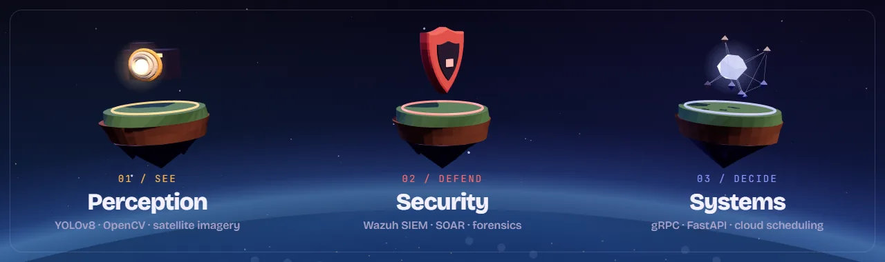
  
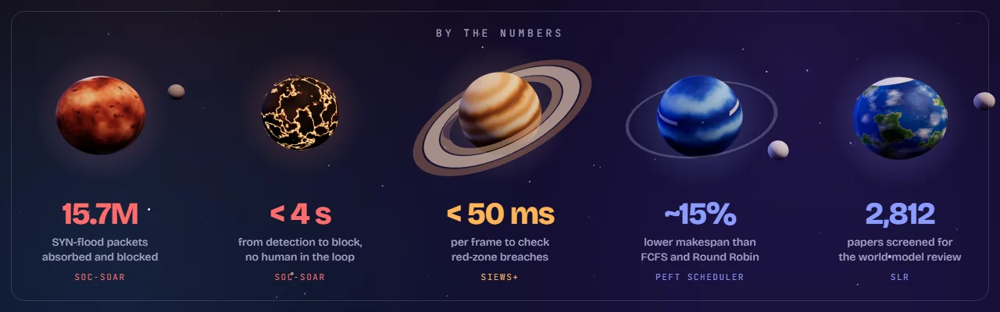

## Featured work

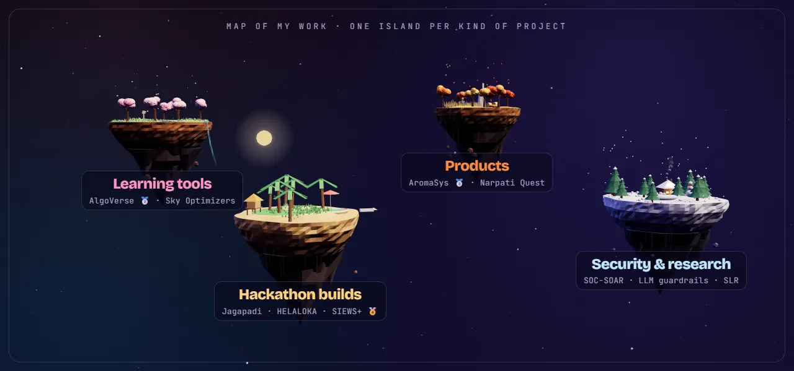
🌸 <b>Learning tools</b> <a href="#p-algoverse">AlgoVerse</a> · <a href="#p-skyopt">Sky Optimizers</a> &nbsp;|&nbsp; 🏝️ <b>Hackathon builds</b> <a href="#p-jagapadi">Jagapadi</a> · <a href="#p-helaloka">HELALOKA</a> · <a href="#p-siews">SIEWS+</a> &nbsp;|&nbsp; 🍂 <b>Products</b> <a href="#p-aromasys">AromaSys</a> · <a href="#p-narpati">Narpati Quest</a> &nbsp;|&nbsp; ❄️ <b>Security &amp; research</b> <a href="#p-soc">SOC‑SOAR</a> · <a href="#research">Papers</a>

<table>
  <tr>
    <td colspan="2" align="center">
      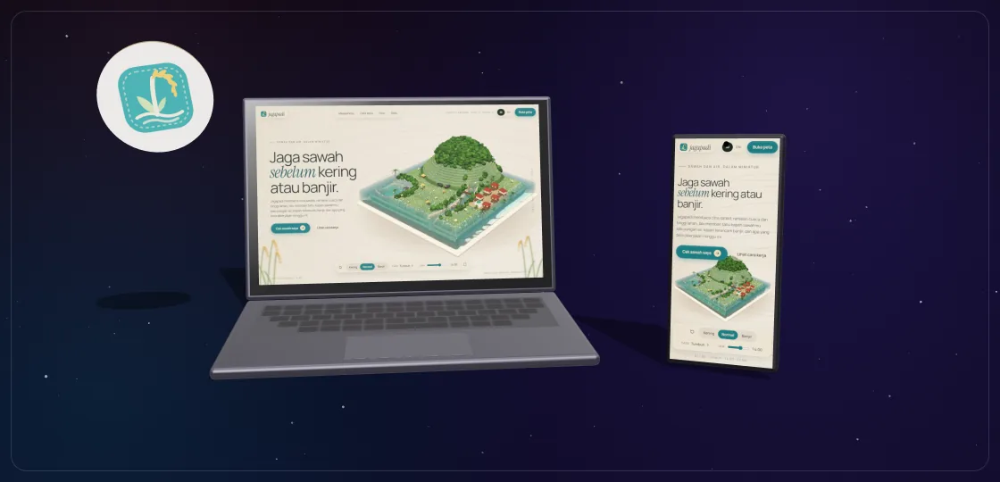
      <h3>Jagapadi · rice fields, watched from orbit</h3>
      <b>UM Metro Hackathon 2026</b> · team of three · <a href="https://github.com/ITHACKITS">ITHACKITS</a>
      
Sentinel-1 radar and Sentinel-2 imagery plus weather ensembles feed a water-balance model for fields in Metro, Lampung. 
      Farmers get plain-language verdicts and Telegram alerts on drought, flood and pest risk; extension officers get a group dashboard and a 3D field diorama.

      
<code>FastAPI</code> <code>React</code> <code>Three.js</code> <code>Sentinel-1/2</code> <code>Open-Meteo</code> <code>Telegram</code>

      Repository is private during judging.
    </td>
  </tr>
  <tr>
    <td width="50%" valign="top">
      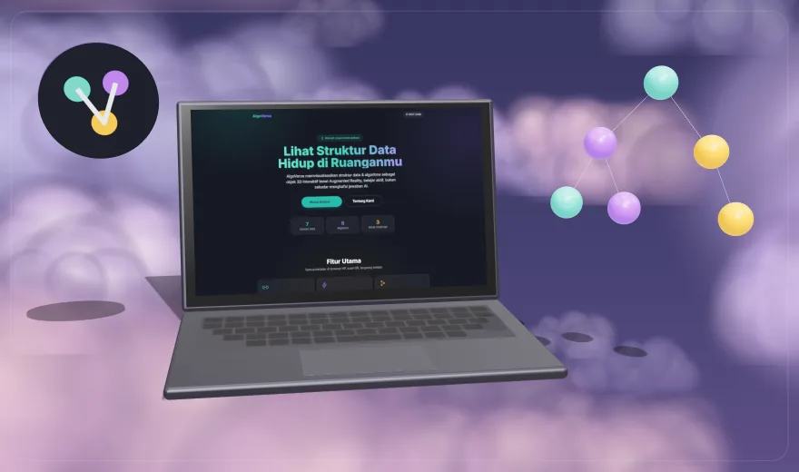
      <h3>AlgoVerse &nbsp;🥈</h3>
      <b>2nd place · IT Fest 2026, Universitas Brawijaya</b>
      
Data structures and algorithms as interactive 3D objects in Augmented Reality, straight from a phone browser: 7 data structures, 8 algorithms and 3 challenge modes, with step-by-step playback of every comparison and swap.

      
<code>WebAR</code> <code>Three.js</code> <code>JavaScript</code> <code>Vercel</code>

      <a href="https://semoga-kami-beruntung.vercel.app/">Live ↗</a> · <a href="https://github.com/MFaqihRidh0/Semoga-Kami-Beruntung">Repository</a>
    </td>
    <td width="50%" valign="top">
      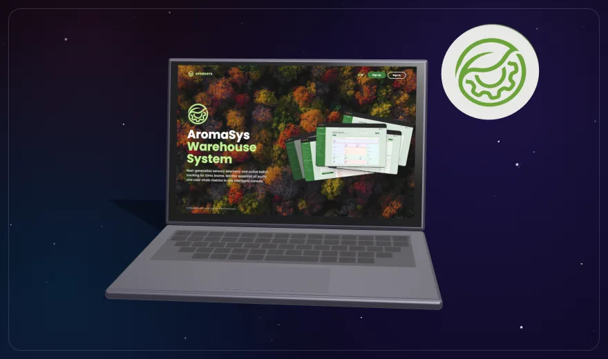
      <h3>AromaSys &nbsp;🥈</h3>
      <b>2nd place · Cyberhack Hackathon</b> (Xtremax × UCS ITS) · lead developer
      
Digital-twin floor plan with live sensor and cold-chain telemetry, Roboflow computer-vision quality control, a Gemini 2.5 Flash operations copilot, 4-role RBAC and FIFO expiry tracking.

      
<code>Next.js 16</code> <code>Express 5</code> <code>PostgreSQL</code> <code>Gemini</code> <code>Roboflow</code>

      <a href="https://cyberhack-digendong-bokem.vercel.app/">Live ↗</a> · <a href="https://github.com/aryarefman/cyberhack-digendong-bokem">Repository</a>
    </td>
  </tr>
  <tr>
    <td width="50%" valign="top">
      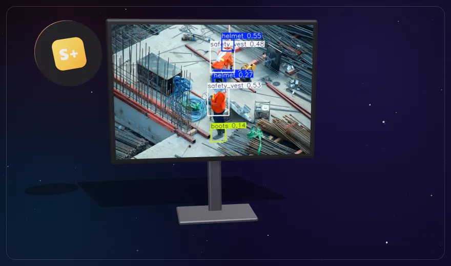
      <h3>SIEWS+ 5.0 &nbsp;🏅</h3>
      <b>Finalist · Hackathon AI/ML Hulu Migas 2026</b> (SKK Migas × IOG 4.0)
      
YOLOv8 on live RTSP streams checks PPE and detects people inside red-zone polygons in under 50 ms per frame, triggers fail-safe shutdown signals, and pushes alerts over WebSocket and WhatsApp.

      
<code>Python</code> <code>FastAPI</code> <code>YOLOv8</code> <code>OpenCV</code> <code>Next.js</code>

      <a href="https://github.com/aryarefman/migas-siews">Repository</a>
    </td>
    <td width="50%" valign="top">
      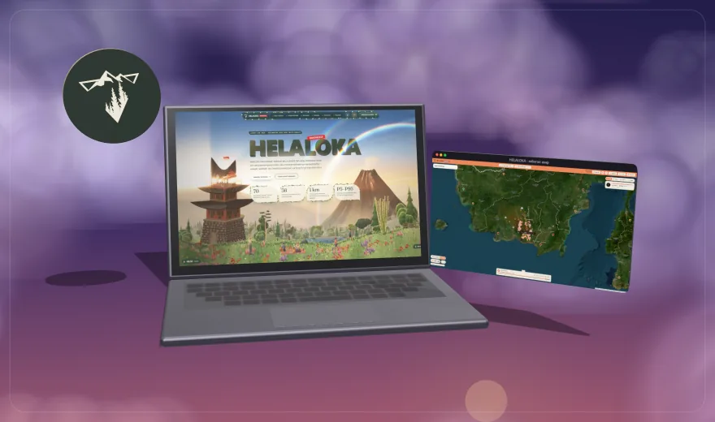
      <h3>HELALOKA</h3>
      <b>JOINTS UGM 2026</b> · volcanic ash &amp; wildfire smoke · top contributor
      
One Lagrangian particle engine (RK2) simulates both ash and smoke across Indonesia: 70 volcanoes with MAGMA levels and 36 fire-prone forest and peat areas, with P5/P50/P95 impact ranges, clinics in the plume and routes to hospitals outside it.

      
<code>JavaScript</code> <code>Python</code> <code>NASA FIRMS</code> <code>MAGMA</code> <code>Ensembles</code>

      <a href="https://helaloka.up.railway.app/">Live ↗</a> · <a href="https://github.com/nyarikerja/JOINTS2026">Repository</a>
    </td>
  </tr>
  <tr>
    <td width="50%" valign="top">
      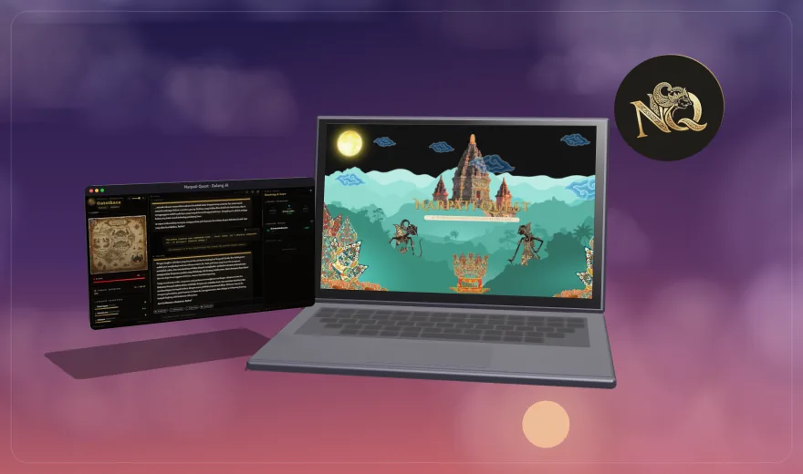
      <h3>Narpati Quest</h3>
      <b>AI text RPG in the world of Javanese wayang</b> · lead contributor
      
An interactive Mahabharata adventure narrated by a "Dalang AI" game master. It works with Gemini, OpenAI, Groq, DeepSeek, OpenRouter or a custom endpoint, and uses retrieval to stay true to the wayang lore.

      
<code>TypeScript</code> <code>Next.js</code> <code>LLMs</code> <code>RAG</code>

      <a href="https://web-sable-three-46.vercel.app">Play it ↗</a> · repository is private
    </td>
    <td width="50%" valign="top">
      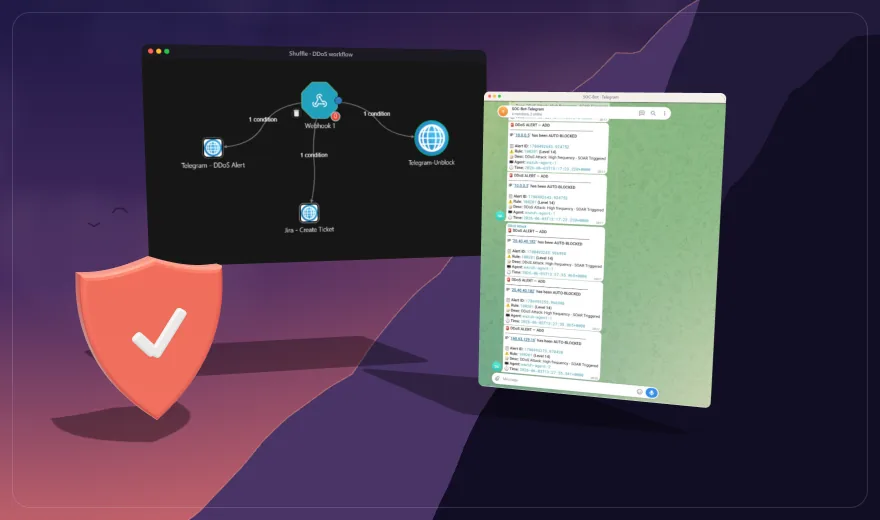
      <h3>SOC-SOAR</h3>
      <b>Automated DDoS detection &amp; response</b>
      
Custom Wazuh decoders spot SYN-flood state exhaustion, an active-response script drops the attacker with iptables, and Shuffle opens a Jira ticket and posts to Telegram. Detection to block in under 4 seconds, no human in the loop.

      
<code>Wazuh</code> <code>Shuffle SOAR</code> <code>Jira API</code> <code>Telegram</code> <code>Bash</code>

      <a href="https://github.com/aryarefman/soc-soar">Repository</a>
    </td>
  </tr>
  <tr>
    <td colspan="2" align="center">
      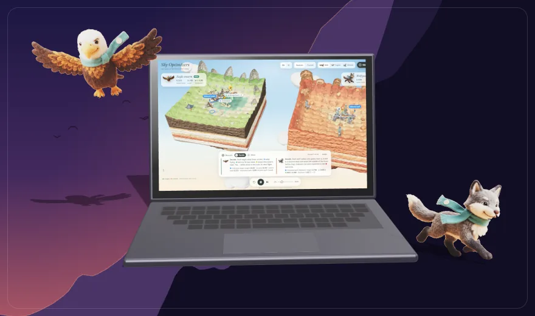
      <h3>Sky Optimizers</h3>
      <b>Interactive 3D teaching animation</b>
      
Watch Particle Swarm Optimization and the Grey Wolf Optimizer search the same landscape step by step on floating islands, with a narrated explainer on how both are used in cloud computing. English and Indonesian.

      
<code>Three.js</code> <code>JavaScript</code> <code>Metaheuristics</code>

      <a href="https://aryarefman.github.io/metaheuristik-pso-gwo/">Live ↗</a> · <a href="https://github.com/aryarefman/metaheuristik-pso-gwo">Repository</a>
    </td>
  </tr>
</table>

## Research

| Paper | Summary |
| :--- | :--- |
| 🧠 **[Least-Privilege Guardrails for Multilingual LLM Agents](https://github.com/aryarefman/paper)** | A deterministic verifier that catches over-privileged tool calls by LLM agents in English, Indonesian and Javanese, tested on SEA-LION, Qwen 2.5, Llama 3.1 and GPT-4o. |
| 📚 **[JEPA vs generative world models](https://github.com/aryarefman/penulisan-ilmiah)** | PRISMA 2020 systematic review: 2,812 records from 8 databases narrowed to 42 studies. |

## Team &amp; organisation work

| Project | What I worked on | Team |
| :--- | :--- | :--- |
| [IBL 2K26](https://ibl-eta.vercel.app) | Head of Backend: open-recruitment site for the ITS Basketball League | [ibl-project](https://github.com/ibl-project) |
| Website ARA 8.0 | Head of IT Dev Division: event website with registration, dashboards and CTFd; top contributor | ARenewalAgent-ITS |
| [Standbai / UdaraSiaga](https://github.com/ITHACKITS/FE-FORGEHACK-2026) | Smoke and ash forecasts with household alerts, ForgeHacks Online 2026 | [ITHACKITS](https://github.com/ITHACKITS) |
| [KECAMATRAS](https://github.com/airenmeyy/kelompok-1-eas-bigdata) | Kecamatan Metrics &amp; Anomaly Tracking of Surabaya: big-data pipeline and geospatial dashboard; top contributor | ITS Big Data course |
| [Order Processing Service](https://github.com/baboey/fp-tka-1) | Cloud deployment with endpoint and Locust load testing; top contributor | ITS Cloud Computing course |
| [Diffie-Hellman &amp; ElGamal](https://github.com/rezcape/Kriptografi_Diffie-Hellman-dan-ElGamal) | Key exchange and public-key encryption implementations in Python; main contributor | Cryptography course |
| [ITS Secure Network Challenge](https://github.com/zelebwr/its-secure-network-challenge) | Network security challenge | ITS |

<b>More of my own projects</b>

 

| Project | What it is | Stack |
| :--- | :--- | :--- |
|  [NovaPulse](https://github.com/aryarefman/grpc-project) | Smart-city backbone with unary, server-streaming and bidirectional gRPC; reroutes traffic when air-quality sensors cross toxic thresholds | Node.js · gRPC · MQTT · Docker |
| [PEFT Cloud Scheduler](https://github.com/aryarefman/soka-peft-heuristik) | Predict Earliest Finish Time on CloudSim Plus: ~15% lower makespan and 12% less energy than FCFS and Round Robin over 1,000 tasks | Java 21 · CloudSim Plus |
| [Digital Forensics Casebook](https://github.com/aryarefman/forensik-digital) | Five hash-verified cases: GPT recovery, FAT32 carving, LSB steganography, JPEG trailing data, following ISO/IEC 27037 | Python · Autopsy |
| [Global AQI analysis](https://github.com/aryarefman/analisis-AQI-Dunia) 🏅 | PCA, Kruskal-Wallis and K-Means/DBSCAN on world air-quality data; finalist at IMILKOM IT Competition | Python · Jupyter |
| [CampusReport](https://github.com/aryarefman/CampusReport) | Civic issue reporting platform for campus facilities | TypeScript |
| [WordIT](https://github.com/aryarefman/FP-PemrogramanWebsite-FE-2025) | Game-based learning website ([backend](https://github.com/aryarefman/FP-PemrogramanWebsite-BE-2025)) | TypeScript |
| [Yayasan ARA network](https://github.com/aryarefman/Final-Project-Komdat-Jarkom) | Network infrastructure design with VLSM/CIDR subnetting | Cisco Packet Tracer |
| [Kotlin](https://github.com/aryarefman/aplikasi-kotlin) / [Flutter](https://github.com/aryarefman/aplikasi-flutter) apps | Native Android and cross-platform mobile prototypes | Kotlin · Dart |

## Toolbox

  

  

## Contributions

<picture>
  <source media="(prefers-color-scheme: dark)" srcset="https://raw.githubusercontent.com/aryarefman/aryarefman/output/pacman-contribution-graph-dark.svg" />
  <source media="(prefers-color-scheme: light)" srcset="https://raw.githubusercontent.com/aryarefman/aryarefman/output/pacman-contribution-graph.svg" />
  
</picture>

 

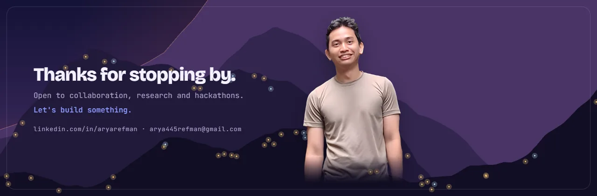
3D scenes and device mockups are made with three.js and rendered frame by frame. Source: <a href="assets/src">assets/src</a>

