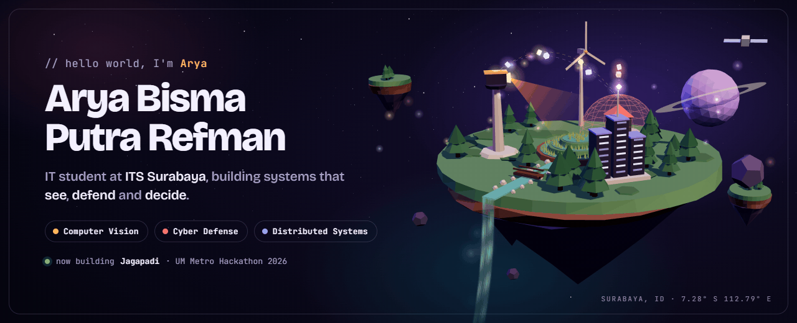
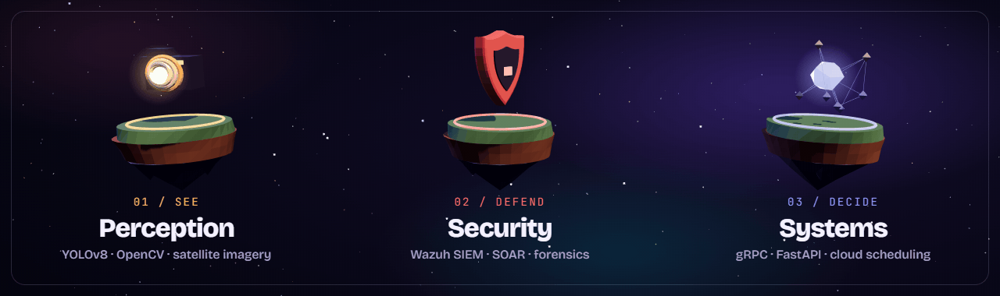
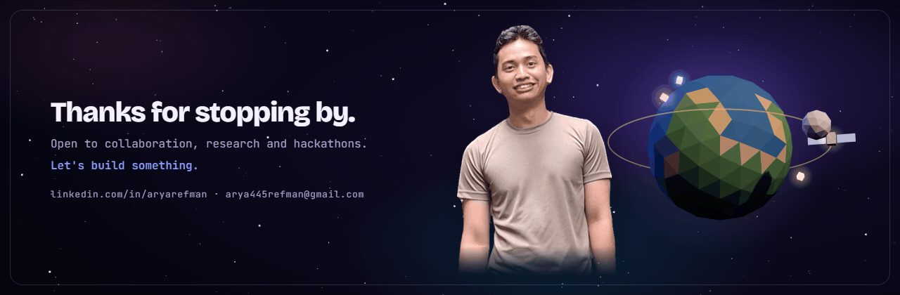

<picture>
  <source media="(prefers-color-scheme: dark)" srcset="assets/hero-dark.gif" />
  <source media="(prefers-color-scheme: light)" srcset="assets/hero-light.gif" />
  
</picture>

     

 

<table>
  <tr>
    <td width="34%" align="center" valign="top">
      
    </td>
    <td width="66%" valign="top">
      <h3>About me</h3>
      

        I study <b>Information Technology at Institut Teknologi Sepuluh Nopember (ITS)</b> in Surabaya, Indonesia.
        I like building systems that close the loop: they <b>see</b> what is happening, <b>defend</b> what matters, and help people <b>decide</b> what to do next.
      

      

        That has meant YOLOv8 safety geofencing for oil and gas sites, a Wazuh + Shuffle SOAR pipeline that blocked a 15.7-million-packet SYN flood on its own,
        gRPC microservices for a smart city, satellite-based rice field monitoring, and a research paper on least-privilege guardrails for multilingual LLM agents.
      

      

        <b>Now:</b> LLM agent security · JEPA world models · cloud scheduling heuristics 
        <b>Open to:</b> research collaboration, internships and hackathon teams
      

    </td>
  </tr>
</table>

 

<picture>
  <source media="(prefers-color-scheme: dark)" srcset="assets/pillars-dark.gif" />
  <source media="(prefers-color-scheme: light)" srcset="assets/pillars-light.gif" />
  
</picture>

## Featured work

<table>
  <tr>
    <td width="50%" valign="top">
      <h3>🏭 AromaSys</h3>
      <b>Warehouse intelligence platform</b> · Lead developer
      
Digital-twin floor plan with live sensor and cold-chain telemetry, Roboflow computer-vision quality control, a Gemini 2.5 Flash operations copilot, 4-role RBAC and FIFO expiry tracking.

      
<code>Next.js 16</code> <code>Express 5</code> <code>PostgreSQL</code> <code>Gemini</code> <code>Roboflow</code>

      <a href="https://github.com/aryarefman/cyberhack-digendong-bokem">Repository</a> · <a href="https://cyberhack-digendong-bokem.vercel.app/">Live demo ↗</a>
    </td>
    <td width="50%" valign="top">
      <h3>🛢️ SIEWS+ 5.0</h3>
      <b>AI early warning for oil &amp; gas</b> · IOC Digital Hackathon 2026
      
YOLOv8 on live RTSP streams detects people inside red-zone polygons in under 50 ms per frame, triggers fail-safe shutdown signals, and pushes alerts over WebSocket and WhatsApp.

      
<code>Python</code> <code>FastAPI</code> <code>YOLOv8</code> <code>OpenCV</code> <code>Next.js</code>

      <a href="https://github.com/aryarefman/migas-siews">Repository</a>
    </td>
  </tr>
  <tr>
    <td width="50%" valign="top">
      <h3>🛡️ SOC-SOAR</h3>
      <b>Automated DDoS detection &amp; response</b>
      
Custom Wazuh decoders spot SYN-flood state exhaustion, an active-response script drops the attacker with iptables, and Shuffle opens a Jira ticket and sends a Telegram alert. Detection to mitigation in under 4 seconds, no human in the loop.

      
<code>Wazuh</code> <code>Shuffle SOAR</code> <code>Jira API</code> <code>Telegram</code> <code>Bash</code>

      <a href="https://github.com/aryarefman/soc-soar">Repository</a>
    </td>
    <td width="50%" valign="top">
      <h3>🌾 Jagapadi</h3>
      <b>Rice field drought, flood &amp; pest monitor</b> · UM Metro Hackathon 2026 (team)
      
Sentinel-1 radar and Sentinel-2 imagery plus weather ensembles feed a water-balance model for fields in Metro, Lampung. Farmers get plain-language verdicts and Telegram alerts; extension officers get a group dashboard and a 3D field diorama.

      
<code>FastAPI</code> <code>React</code> <code>Three.js</code> <code>Sentinel-1/2</code> <code>Open-Meteo</code>

      Repository is private during judging.
    </td>
  </tr>
  <tr>
    <td width="50%" valign="top">
      <h3>🧠 Least-Privilege Guardrails</h3>
      <b>Research paper</b> · multilingual LLM agents
      
A deterministic verifier that catches over-privileged tool calls by LLM agents in English, Indonesian and Javanese, testing whether safety holds across languages on SEA-LION, Qwen 2.5, Llama 3.1 and GPT-4o.

      
<code>Python</code> <code>LLM agents</code> <code>Tool use</code> <code>Security</code>

      <a href="https://github.com/aryarefman/paper">Repository</a>
    </td>
    <td width="50%" valign="top">
      <h3>🦅 Sky Optimizers</h3>
      <b>Interactive 3D teaching animation</b>
      
Watch Particle Swarm Optimization and the Grey Wolf Optimizer search the same landscape step by step on floating islands, with a narrated explainer on how both are used in cloud computing. English and Indonesian.

      
<code>Three.js</code> <code>JavaScript</code> <code>Metaheuristics</code>

      <a href="https://github.com/aryarefman/metaheuristik-pso-gwo">Repository</a> · <a href="https://aryarefman.github.io/metaheuristik-pso-gwo/">Live demo ↗</a>
    </td>
  </tr>
</table>

<b>More projects</b>

 

| Project | What it is | Stack |
| :--- | :--- | :--- |
| [NovaPulse](https://github.com/aryarefman/grpc-project) | Smart-city backbone with unary, server-streaming and bidirectional gRPC; reroutes traffic when air-quality sensors cross toxic thresholds | Node.js · gRPC · MQTT · Docker |
| [PEFT Cloud Scheduler](https://github.com/aryarefman/soka-peft-heuristik) | Predict Earliest Finish Time on CloudSim Plus: ~15% lower makespan and 12% less energy than FCFS and Round Robin over 1,000 tasks | Java 21 · CloudSim Plus |
| [World Model SLR](https://github.com/aryarefman/penulisan-ilmiah) | PRISMA 2020 review of JEPA vs generative world models: 2,812 records from 8 databases narrowed to 42 studies | Python · LaTeX |
| [Digital Forensics Casebook](https://github.com/aryarefman/forensik-digital) | Five hash-verified cases: GPT recovery, FAT32 carving, LSB steganography, JPEG trailing data, following ISO/IEC 27037 | Python · Autopsy |
| [CampusReport](https://github.com/aryarefman/CampusReport) | Civic issue reporting platform for campus facilities | TypeScript |
| [WordIT](https://github.com/aryarefman/FP-PemrogramanWebsite-FE-2025) | Game-based learning website ([backend](https://github.com/aryarefman/FP-PemrogramanWebsite-BE-2025)) | TypeScript |
| [Yayasan ARA network](https://github.com/aryarefman/Final-Project-Komdat-Jarkom) | Network infrastructure design with VLSM/CIDR subnetting | Cisco Packet Tracer |
| [Global AQI analysis](https://github.com/aryarefman/analisis-AQI-Dunia) | Exploratory analysis of world air-quality data | Python · Jupyter |
| [Kotlin](https://github.com/aryarefman/aplikasi-kotlin) / [Flutter](https://github.com/aryarefman/aplikasi-flutter) apps | Native Android and cross-platform mobile prototypes | Kotlin · Dart |

## Toolbox

  

  

## Contributions

<picture>
  <source media="(prefers-color-scheme: dark)" srcset="https://raw.githubusercontent.com/aryarefman/aryarefman/output/pacman-contribution-graph-dark.svg" />
  <source media="(prefers-color-scheme: light)" srcset="https://raw.githubusercontent.com/aryarefman/aryarefman/output/pacman-contribution-graph.svg" />
  
</picture>

 

<picture>
  <source media="(prefers-color-scheme: dark)" srcset="assets/footer-dark.gif" />
  <source media="(prefers-color-scheme: light)" srcset="assets/footer-light.gif" />
  
</picture>
3D scenes are made with three.js and rendered frame by frame. Source: <a href="assets/src">assets/src</a>

